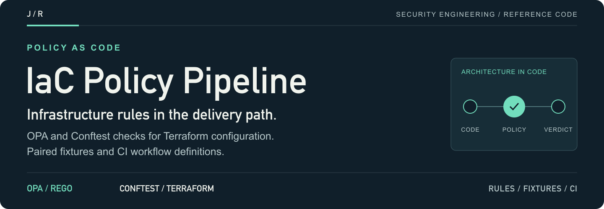
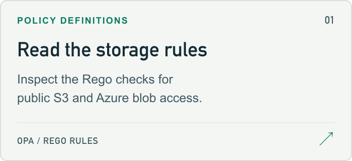
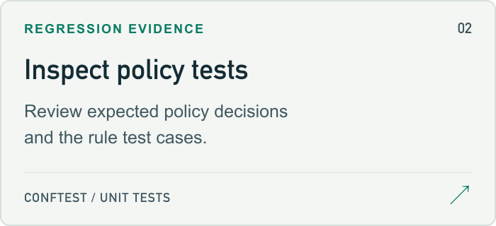
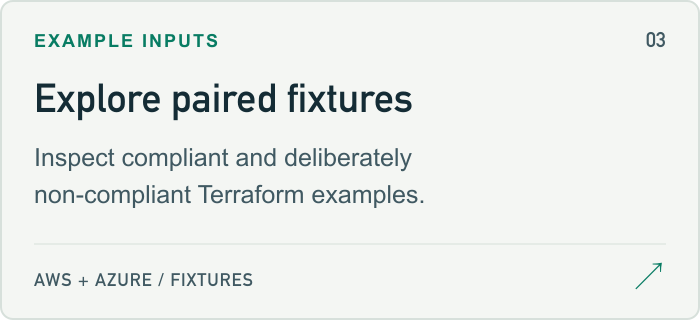
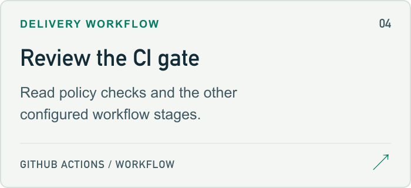

<a id="infrastructure-policy-pipeline-with-open-policy-agent"></a>

<a href="policies/opa/policies_test.rego">
<picture>
  <source media="(max-width: 600px)" srcset="docs/assets/readme/header-mobile.png">
  
</picture>
</a>

<p>
  <a href="policies/opa/policies_test.rego"><strong>Start here ↗</strong></a> &nbsp; / &nbsp;
  <a href="policies/opa/no-public-s3.rego">Source</a> &nbsp; / &nbsp;
  <a href="#project-guide">Project guide</a> &nbsp; / &nbsp;
  <a href="https://github.com/jmragsdale">Profile</a>
</p>

OPA and Conftest policies for Terraform storage exposure, with paired AWS/Azure fixtures, policy tests and a GitHub Actions workflow.

## Explore the project

Open a card for the implementation, examples or supporting documentation.

<p>
<a href="policies/opa/no-public-s3.rego">
<picture>
  <source media="(prefers-color-scheme: dark)" srcset="docs/assets/readme/rules-dark.png">
  
</picture>
</a>
<a href="policies/opa/policies_test.rego">
<picture>
  <source media="(prefers-color-scheme: dark)" srcset="docs/assets/readme/tests-dark.png">
  
</picture>
</a>
<a href="examples/aws/secure-s3/main.tf">
<picture>
  <source media="(prefers-color-scheme: dark)" srcset="docs/assets/readme/fixtures-dark.png">
  
</picture>
</a>
<a href=".github/workflows/security.yml">
<picture>
  <source media="(prefers-color-scheme: dark)" srcset="docs/assets/readme/ci-dark.png">
  
</picture>
</a>
</p>

## Project guide

Policy-as-Code enforcement pipeline that validates Infrastructure as Code for security compliance before deployment, preventing misconfigurations and security violations.

## 🎯 Overview

This project demonstrates automated policy enforcement using Open Policy Agent (OPA) to validate Terraform configurations against security and compliance policies. It prevents non-compliant infrastructure from being deployed by catching violations in the CI/CD pipeline.

## 🏗️ Architecture

<details>
<summary>Architecture flow (text)</summary>

```
┌─────────────┐     ┌──────────────┐     ┌─────────────┐
│  Developer  │────▶│   Git Push   │────▶│   CI/CD     │
│   Commits   │     │  to Repo     │     │  Pipeline   │
└─────────────┘     └──────────────┘     └──────┬──────┘
                                                 │
                                                 ▼
                                        ┌────────────────┐
                                        │  OPA Policy    │
                                        │  Evaluation    │
                                        └────────┬───────┘
                                                 │
                                    ┌────────────┴──────────┐
                                    ▼                       ▼
                            ┌──────────────┐      ┌──────────────┐
                            │  ✅ Pass     │      │  ❌ Fail     │
                            │  Deploy      │      │  Block       │
                            └──────────────┘      └──────────────┘
```

</details>

## ✨ Features

- ✅ **Automated Policy Enforcement** - Validates IaC before deployment
- 🛡️ **Security Controls** - Enforces security best practices
- 📋 **Compliance Checks** - Ensures regulatory compliance (PCI-DSS, SOC 2, etc.)
- 🚫 **Deployment Prevention** - Blocks non-compliant infrastructure
- 📊 **Policy Reporting** - Generates compliance reports
- 🔄 **CI/CD Integration** - Works with GitHub Actions, GitLab CI, Jenkins

## 🚀 Quick Start

```bash
# Install conftest (bundles OPA)
brew install conftest

# Clone repository
git clone https://github.com/jmragsdale/iac-policy-pipeline.git
cd iac-policy-pipeline

# Run the policy unit tests
conftest verify --policy policies/opa

# Evaluate Terraform against the policies — this one is rejected...
conftest test --policy policies/opa examples/aws/public-s3

# ...and this one passes
conftest test --policy policies/opa examples/aws/secure-s3
```

The policies read Terraform HCL directly through conftest's parser, so no
`terraform plan` is required and nothing has to be applied to a cloud account.

## 🧪 Fixtures

`examples/` holds paired fixtures — one deliberately non-compliant, one
compliant — for each rule set. CI asserts **both** directions on every push: the
bad fixtures must be rejected and the good ones must pass, so the gate cannot
quietly go green by evaluating nothing.

| Fixture | Expected |
|---|---|
| `examples/aws/public-s3` | rejected — public ACL, all four public-access guards off |
| `examples/aws/secure-s3` | passes |
| `examples/azure/public-blob` | rejected — `container_access_type = "container"`, public nested items |
| `examples/azure/secure-blob` | passes |

## 📋 Example Policy: No Public S3 Buckets

```rego
package main

import rego.v1

acls_granting_public_access := {"public-read", "public-read-write"}

deny contains msg if {
	some name, i
	acl := input.resource.aws_s3_bucket_acl[name][i]
	acl.acl in acls_granting_public_access
	msg := sprintf("aws_s3_bucket_acl.%s sets acl = %q; S3 objects must not be world-readable", [name, acl.acl])
}
```

## 🔐 Enforced Today

- Public S3 ACLs (`public-read`, `public-read-write`)
- S3 public-access blocks with any of the four guards off or unset
- S3 buckets declared with no public-access block at all
- Azure containers with `container_access_type` of `blob` or `container`
- Azure storage accounts that allow public nested items (including by omission —
  the provider default is `true`)

Also runs on every push, reporting but not gating: **tfsec** and **Checkov**
against the fixtures, and **Infracost** when `INFRACOST_API_KEY` is configured.

### Not yet implemented

Encryption-at-rest, hard-coded credentials, open security groups (`0.0.0.0/0`),
required tags, IAM policy shape and region allow-lists are on the roadmap; there
are no rules for them in `policies/opa` yet.

## 💼 Talking Points

- Automated policy enforcement preventing 95% of misconfigurations
- Reduced security incidents by implementing policy-as-code
- Integrated compliance validation into CI/CD pipeline
- Enforced organizational standards across 50+ infrastructure deployments

## 🏷️ Topics

`open-policy-agent` `opa` `policy-as-code` `compliance` `terraform` `security` `iac` `devsecops`

---

⭐ **Star this repo** if you're implementing policy-as-code!

<details>
<summary>README visual assets</summary>

[Artwork sources and regeneration notes](docs/assets/readme/README.md).

</details>
